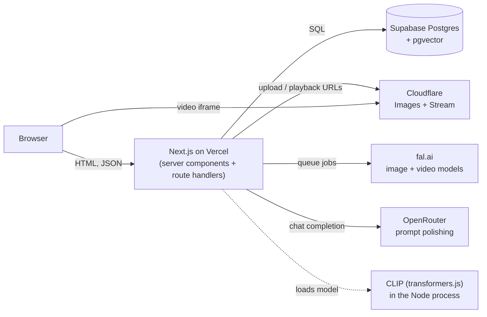
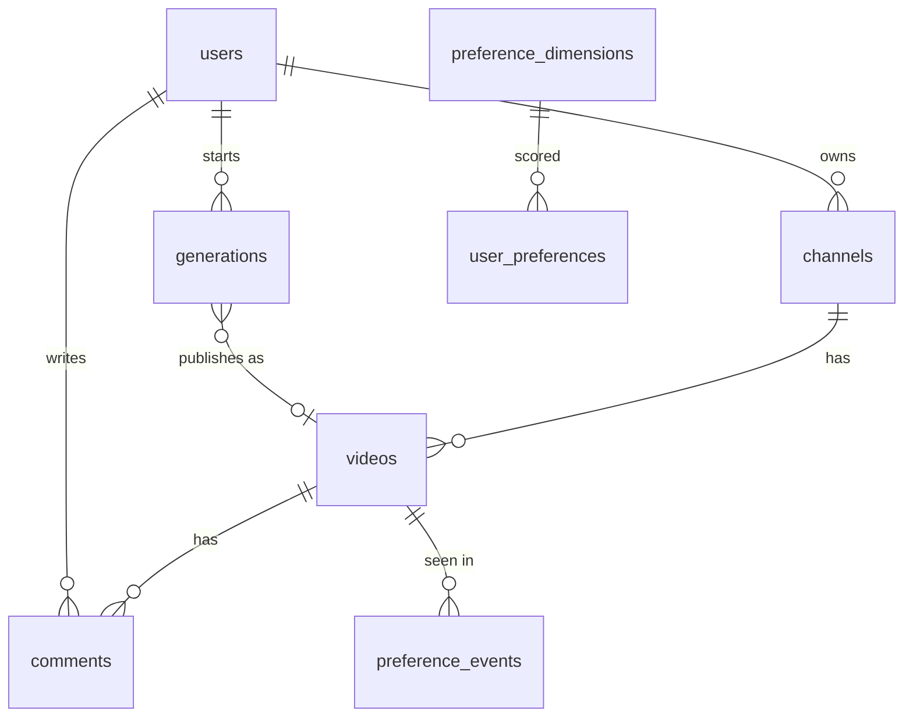
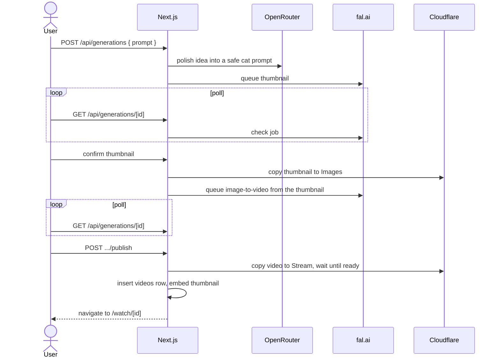

# Architecture

This document explains how YourTube works and why it was built this way. For setup and day-to-day commands see the [README](../README.md).

## Contents

1. [Overview](#overview)
2. [Rendering model](#rendering-model)
3. [Data layer](#data-layer)
4. [Authentication](#authentication)
5. [Media: Cloudflare Images and Stream](#media-cloudflare-images-and-stream)
6. [AI video creation pipeline](#ai-video-creation-pipeline)
7. [CLIP and vector search](#clip-and-vector-search)
8. [Related videos](#related-videos)
9. [Preference learning](#preference-learning)
10. [Recommendations](#recommendations)
11. [Embeddings in production](#embeddings-in-production)
12. [Security notes](#security-notes)
13. [Design decisions and trade-offs](#design-decisions-and-trade-offs)

---

## Overview

The app is a single Next.js project. There is no separate backend: pages are server components that query the database directly, and the few JSON endpoints are route handlers in the same codebase. External services are used for things that should not run in the app: storing and streaming media (Cloudflare), generating media (fal.ai), and language tasks (OpenRouter).

## Rendering model

Every page is a **React server component**: it runs on the server, queries Postgres, and sends HTML. No page file is a client component. Small **client components** are used only where the browser is needed: the search box, the sidebar and theme toggle, the account menu, the create-video form, the watch-time tracker, and the debug page's refresh controls.

Consequences:

- Pages are rendered on demand rather than prebuilt. Some are explicitly per-request because they read cookies, the session or query parameters (`/`, `/search`, `/debug`, `/create`, `/login`, `/signup`).
- There is no client-side data layer (no React Query or similar). Pages fetch on the server, and client components call a handful of `fetch` endpoints.
- Mutations from the admin panel use **server actions** and then call `revalidatePath` so pages show the new data.

This version of Next.js has breaking changes compared with older releases, so check `node_modules/next/dist/docs/` when changing framework-level code.

## Data layer

**Postgres on Supabase**, accessed through **Drizzle ORM** with the `postgres` driver.

- The schema lives in one file, [`drizzle/schema.ts`](../drizzle/schema.ts). Migrations are generated from it with `drizzle-kit` and committed in `drizzle/migrations`.
- The connection uses Supabase's **transaction pooler**, which does not support prepared statements, so the client is created with `prepare: false`.
- Primary keys are UUIDs. Display counters such as views and likes are stored as formatted text (for example `"1.2M views"`) because the data is demo content.

Tables for Better Auth (`users`, `sessions`, `accounts`, `verifications`) share the database. `users` doubles as the auth user table and as the source of display-only users such as comment authors, who have no email and cannot sign in.

### Vectors with pgvector

The `vector` extension is created by a migration. Two kinds of vectors are stored, both 512-dimensional:

- `videos.thumbnail_embedding`: what each thumbnail looks like.
- `preference_dimensions.embedding`: what each taste label means.

`videos.thumbnail_embedding` has an **HNSW index** using cosine distance (`vector_cosine_ops`). HNSW is an approximate nearest-neighbour index: it finds the closest vectors without comparing against every row, and unlike IVFFlat it needs no training data, so it works while the table is small and growing. The 76 dimension rows are not indexed, because a scan of that few rows is cheaper than an index lookup.

## Authentication

[Better Auth](https://www.better-auth.com) with email and password and the Drizzle adapter.

- Sessions are cookies. Server code reads them with `getSession()` in `src/lib/auth.ts`.
- `isAdmin` is a user field that **cannot be set from a sign-up request** (`input: false`). Only server code or `scripts/create-admin.ts` can set it.
- Route handlers and server actions re-check the session on every call, because they can be reached by a direct POST.
- Better Auth rejects requests whose `Origin` is not trusted. It trusts `BETTER_AUTH_URL`, plus the hostnames Vercel provides for the running deployment (`VERCEL_URL` and related variables). A wildcard such as `*.vercel.app` is deliberately not used, since it would trust any Vercel app.

## Media: Cloudflare Images and Stream

The database stores URLs, not files.

- **Thumbnails** go to Cloudflare Images under the custom id `thumbnails/<generationId>`. Cloudflare rejects bare UUIDs as ids, hence the prefix. The public variant URL is stored in `videos.thumbnail_url`.
- **Videos** go to Cloudflare Stream. The player URL (an iframe) is stored in `videos.video_url`, and the watch page embeds it.
- Uploading copies from a URL, so the server never holds the video file.
- Stream returns before a video is processed, and its player shows "video not found" until it is ready. The copy step therefore **polls until ready** (up to 120 seconds), and the publish endpoint allows 180 seconds.

## AI video creation pipeline

A video is made in two stages with a human check between them, because a thumbnail is cheap to generate and a video is expensive.

Key points:

- **Prompt polishing.** The user's idea goes to an LLM with strict instructions: the result must always be a wholesome cat video, refuse nothing, and ignore any instructions inside the idea. This keeps the site on topic and safe, and it is why no hard moderation step is needed.
- **Queue and poll.** fal jobs run asynchronously. The server stores each job's request id on the `generations` row and advances the status when the client polls. This works on serverless hosting, where nothing can wait minutes for a job.
- **Status machine.** `starting → thumbnailing → thumbnail_ready → generating → ready → publishing → published`, plus `failed` and `rejected`. Because status lives in the database, the flow survives page reloads and lets users regenerate a thumbnail.
- **Timeouts.** The video timeout counts from `video_started_at`, not creation time, so the time a user spends reviewing the thumbnail is not counted against the video.
- **Cost control.** Each user has a daily allowance (`DAILY_GENERATION_LIMIT`, default 5) with a hard cap of four times that, counting retries. Refused ideas and starts that failed before reaching fal do not use a slot.
- **Embedding on publish.** The published thumbnail is embedded right after the `videos` row is inserted. If that fails, the video is still published and `embed-thumbnails.ts` backfills it.

## CLIP and vector search

**CLIP** is a model trained on image and caption pairs. It has two encoders, one for images and one for text, that map into the *same* 512-dimension space, so a sentence and a matching picture end up close together. This is what makes searching images with words possible without any tags.

- **Model:** `Xenova/clip-vit-base-patch32`, run in the Node process with transformers.js (ONNX Runtime). No external API is called, so it costs nothing and sends no data out.
- **Normalisation:** every vector is scaled to length 1 (L2 normalisation). Cosine similarity then reduces to comparing direction, and vectors from different inputs are directly comparable.
- **Distance:** pgvector's `<=>` operator is cosine distance, which is `1 − similarity`. Good matches score around 0.3, which is normal for CLIP, so scores are used to *rank*, not as percentages.
- **Search flow:** embed the query with the text encoder, then `ORDER BY thumbnail_embedding <=> query LIMIT 24`. The HNSW index serves this ordering.
- **Source of truth:** `src/lib/clip.ts` exposes `embedThumbnail(url)` and `embedText(query)`, shared by the app and the scripts so that both always use the same model and normalisation. Mixing models or settings would make stored vectors incomparable.
- **Lazy loading.** The library is imported on first use, so only search and publish pay for it. Eagerly importing it made every page fail on Vercel when its native runtime was missing.

## Related videos

`getRelatedVideos(id)` orders every other video by cosine distance to the current video's thumbnail embedding and returns the closest 20. It does not use the viewer's history. Videos with no embedding sort last, so the sidebar degrades to the plain order instead of failing.

## Preference learning

The system learns what each viewer likes from behaviour, and shows its working on `/debug`.

### Dimensions

There are 76 **taste dimensions** in five groups: styles (claymation, noir, pixel art), genres (action, detective, sci-fi), subjects (cats, baking, labs), moods (cozy, dramatic) and settings (rainy nights, neon city). Each has a short text description, such as "a black and white film noir scene with dramatic shadows", embedded with CLIP's text encoder. A video's thumbnail can then be scored against every dimension by cosine similarity. [`scripts/seed-dimensions.ts`](../scripts/seed-dimensions.ts) defines and seeds them and is safe to re-run.

### Signals

| Signal | Sent when | Weight |
|---|---|---|
| `view` | A watch page opens | 0.5 |
| `watch` | Each 5 seconds the tab stays visible on a watch page | 0.5 per tick |

A click only shows that a thumbnail was appealing; time spent shows the video held attention. Clips are about 15 seconds, so a full watch (three ticks) is worth three times the click. The browser stops sending after 10 minutes on one page, and the server ignores watch ticks that arrive faster than every 4 seconds, so a script cannot inflate watch time.

### Update rule

For each signal:

1. Find the 4 dimensions closest to the video's thumbnail.
2. Split the signal's weight among them with a **softmax** over their similarities (sharpness 100, CLIP's own scale), so the best match gets most of it.
3. Multiply **all** of the viewer's scores by `0.98 ^ weight`, then add the boosts.

Step 3 is the forgetting mechanism. Every signal shrinks every score a little, so interests that stop being reinforced fade while active ones grow. This is event-based decay rather than clock-based: an inactive account keeps its profile, and an active one adapts quickly.

All updates for one signal run in a single transaction.

### Who a profile belongs to

A profile key is `user:<id>` when signed in and `anon:<cookie id>` otherwise (an HTTP-only cookie lasting a year). The two are not merged on sign-in. `preference_events` keeps the raw signals so the debug page can show them.

## Recommendations

`getRecommendedVideos(profile)`:

1. Take the viewer's **top 3 dimensions** and turn their scores into weights that sum to 1.
2. Score each video as the sum of `weight × similarity(thumbnail, dimension)`.
3. Sort by that score, with videos the viewer has already opened placed after unseen ones.
4. Return the top 12, along with the three dimension names so the page can say why ("because you like Film noir, Dramatic, Detective & mystery").

With no history, the home page shows the fixed `recommended` section. Recommendations affect the home page only, not search or the watch sidebar.

**Limits.** Everything is based on how thumbnails *look*: titles, tags and video content are not used. CLIP descriptions overlap, so a clay-animated cat can score higher on "Felt & plush" than on "Claymation". Rewording prompts in the seed script and re-running it is the way to tune this.

## Embeddings in production

CLIP runs inside the app process, which is simple and free but has costs on serverless hosting:

- **Native runtime.** `onnxruntime-node` is a native module that Next's file tracing does not include, so `next.config.ts` explicitly bundles its Linux x64 build for `/search` and the publish endpoint only.
- **Cold starts.** The model weights (hundreds of MB) download from Hugging Face into `/tmp` the first time a function instance embeds something, so the first search after idle is slow. Instances reuse the loaded model afterwards.
- **Failure handling.** The search page shows "Search is unavailable" if CLIP cannot load, and publishing does not fail if embedding fails.

If cold starts matter, move embedding behind a small always-warm service or a hosted CLIP endpoint. It **must serve the same ViT-B/32 model**, or every stored embedding has to be recomputed.

## Security notes

- Secrets live in `.env` (git-ignored) or Vercel's environment settings.
- The idea text is untrusted input to an LLM. The system prompt treats it as a topic only and ignores instructions inside it.
- `isAdmin` cannot be set through sign-up, and admin actions re-check the session server-side.
- Preference endpoints validate ids and event kinds, rate-limit watch ticks, and never expose one profile's data to another: the profile key comes from the session or cookie, never from the request body.
- The cookie used for anonymous profiles is HTTP-only and same-site.

## Design decisions and trade-offs

| Decision | Why | Cost |
|---|---|---|
| Server components with direct DB queries | Least code, no API layer to maintain | Every page needs the database to be up |
| pgvector inside the main database | One system, joins with normal data, no sync | Vector load shares the database |
| CLIP in-process | Free, private, no extra service | Cold starts and a native dependency on serverless |
| Dimensions as text embeddings | A new taste dimension is one line of text, no training | Quality depends on how well CLIP reads the description |
| Event-based decay | Simple, needs no timers or jobs | Scores depend on activity volume, not wall-clock time |
| Thumbnail first, then video | Cheap check before an expensive generation | An extra step for the user |
| Poll instead of webhooks | Works on serverless and locally with no public URL | Slightly higher latency and extra requests |
| Text counters for views and likes | Demo content only | Cannot be summed or sorted numerically |
